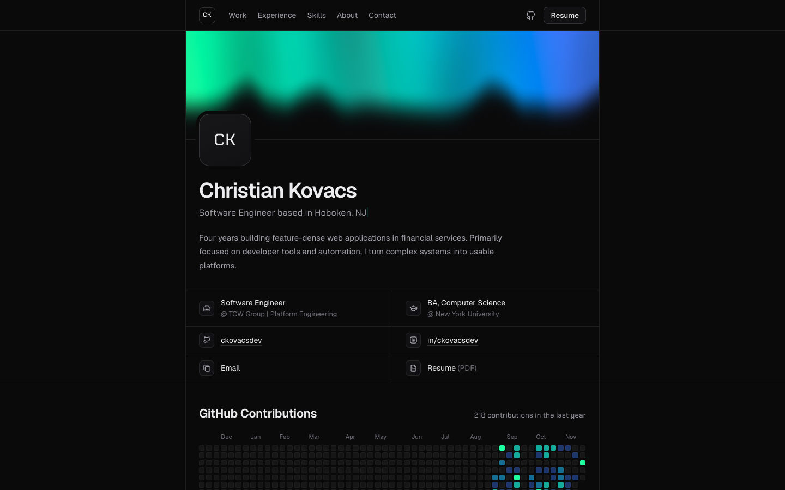
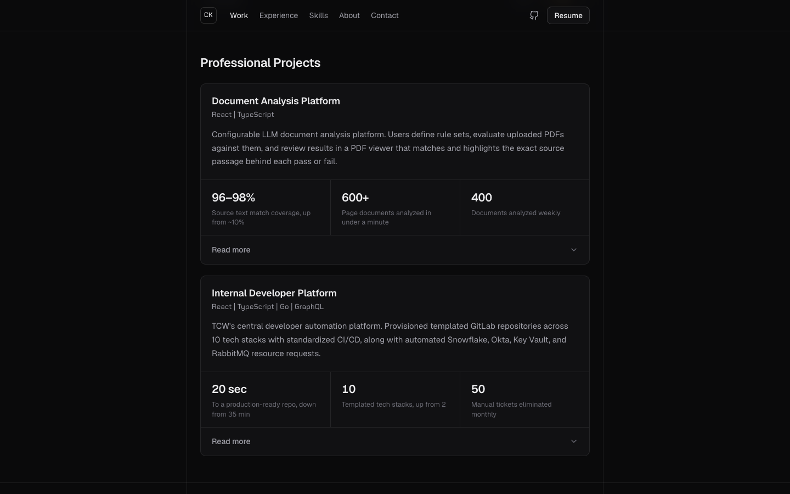
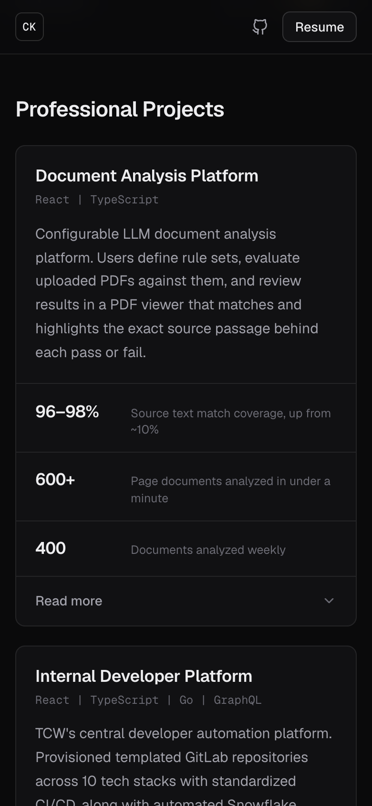

# ckovacs.dev

Personal site and portfolio. Built with React, TypeScript, and Vite.

The first version was hand-built with an art-deco design, then refined with Claude Code. The current version is a redesign done with Claude Code: a dark, single-column profile page.

**Live:** https://ckovacs.dev

## Design

| Desktop | Mobile |
|---|---|
|  |  |
|  |  |

## Design Ideals

- Dark mode only: one near-black palette with a single warm accent, set in Geist with Chakra Petch for a few small accents
- A centered profile page: one column framed by hairline rails, with full-width lines between sections
- Each section shares the same frame but has its own layout: profile facts grid, contribution heatmap, project cards, expandable roles, skills table, contact tiles
- Details on demand: experience roles and project write-ups expand in place
- An aurora banner in the Borealis colors, using the [Aurora](https://reactbits.dev/backgrounds/aurora) background from React Bits: a WebGL shader that drifts toward the cursor and pauses when off screen
- Native scrolling, no scroll hijacking
- Responsive down to phone widths, and respects `prefers-reduced-motion` throughout

## Stack

- React + TypeScript
- Vite
- HTML & CSS
- GSAP, for the cursor in React Bits' [Text Type](https://reactbits.dev/text-animations/text-type) subtitle
- Three.js, for React Bits' [Color Bends](https://reactbits.dev/backgrounds/color-bends) in the page margins on wide screens, loaded after the page
- Deployed on Cloudflare via GitHub Actions
- GitHub contribution data from [github-contributions-api](https://github.com/grubersjoe/github-contributions-api), fetched in the browser

## Running locally

```bash
npm install
npm run dev
```